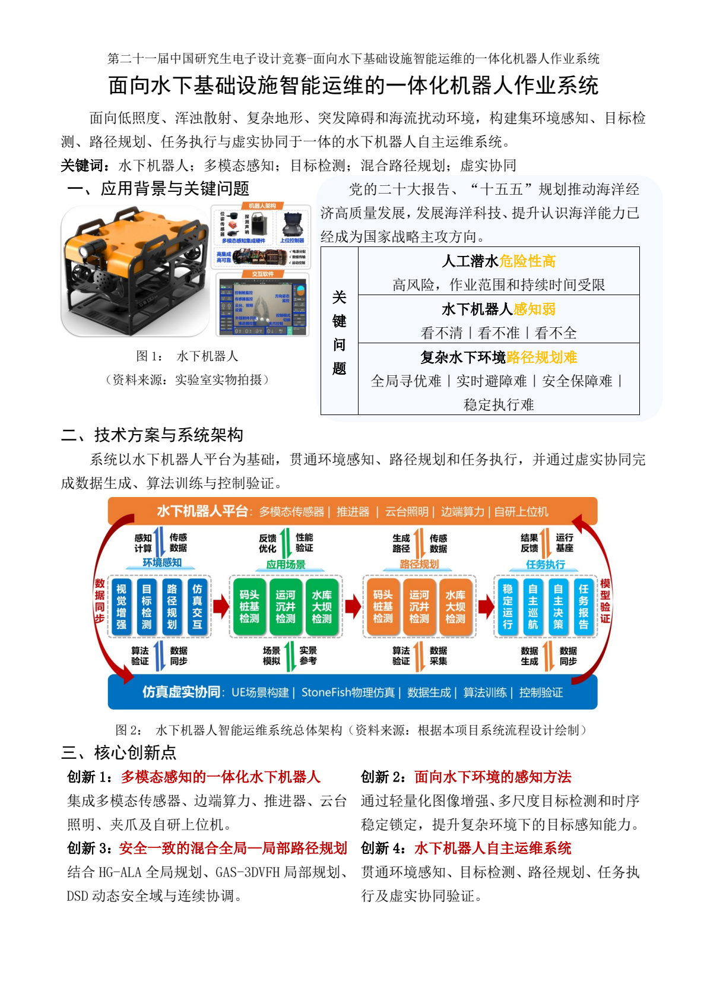
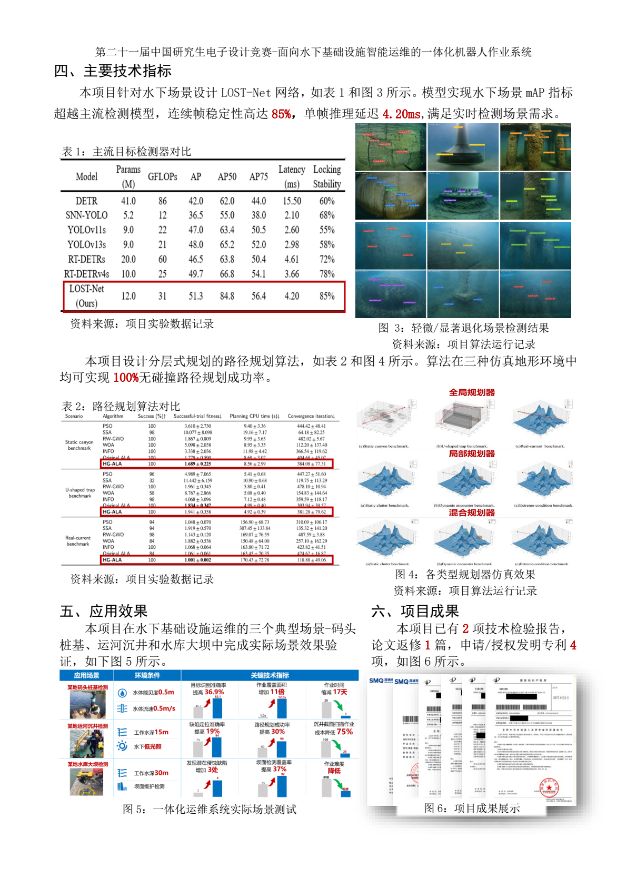
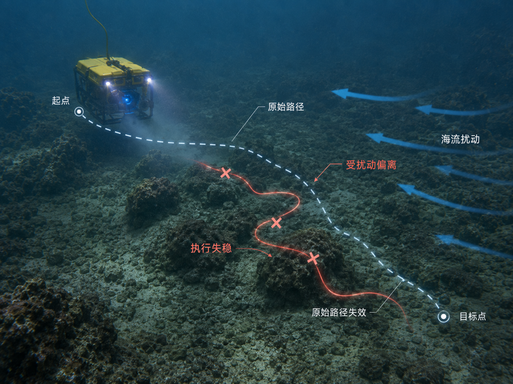
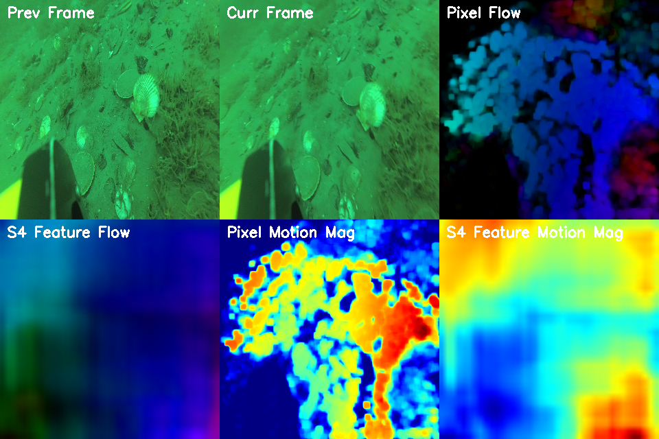
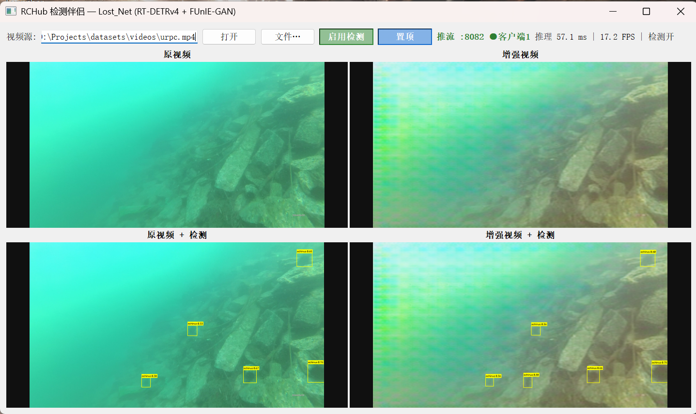

# Integrated Robotic Operation System for Intelligent O&M of Underwater Infrastructure

面向低照度、浑浊散射、复杂地形、突发障碍与海流扰动环境，构建集**环境感知、目标检测、路径规划、大模型决策与虚实协同验证**于一体的水下机器人自主运维系统。

*[English](README.en.md) · **中文***

> 本仓库为参赛/科研项目的**展示版**：包含系统方案、核心创新、实验结果与效果图，**不包含可运行的源码**。大模型决策链路代码（`oceangym-agent/`）、本地模型服务网关（`llm-gateway/`）、检测模型训练代码、UE5 工程与硬件设计文档在**私有仓库**中维护，随论文/专利进度在授权后开放，获取方式见下文「源码获取」。

## 成果一览

| 指标 | 结果 |
|---|---|
| 水下目标检测 | 数据集校准退化增广 + DINOv3 双视图蒸馏（DUET-DETR）：URPC mAP 50.21→**50.89（+0.68）**，多种子六项 COCO 指标全部为正；部署零额外开销（10.4M 参数 / 24.8 GFLOPs） |
| 实时感知 | 连续帧稳定锁定率 **85%**，单帧推理延迟 **4.20 ms** |
| 路径规划 | HG-ALA 全局 + GAS-3DVFH 局部 + DSD 动态安全域，三种仿真地形 **100% 无碰撞** |
| 实测验证 | 码头桩基 / 运河沉井 / 水库大坝三场景：目标识别准确率 **+36.9%**，作业覆盖面积 **×11**，作业时间 **−17 天**（相对人工巡检） |

## 系统展示

| 方案总览（一） | 方案总览（二） |
|---|---|
|  |  |

| 路径规划仿真 | 光流时序特征 | 退化场景检测结果 |
|---|---|---|
|  |  |  |

## 核心创新

1. **多模态感知的一体化水下机器人**：集成位姿、深度、视觉与探测声呐传感器，边缘计算、推进控制、云台照明与自研上位机一体设计。
2. **面向水下退化的感知算法**：轻量级图像增强（YUV 双分支 + DFA 模块，0.044M 参数 / 27.79 dB PSNR）+ DUET-DETR 实时检测（仅训练阶段的视觉基础模型蒸馏，推理图与 RT-DETRv4-S 完全一致）+ 光流时序先验跨帧锁定。
3. **安全一致的混合全局—局部路径规划**：HG-ALA 全局参考 + GAS-3DVFH 局部避障 + DSD 动态安全域 + DSD-GDVS 连续协调，消除全局/局部规划不一致。
4. **大模型驱动的任务决策与虚实协同**：本地 LLM 网关统一纳管多模态模型调用；视觉结果压缩为结构化状态约束模型输出；UE5/OceanGym 高保真仿真完成"数据生成—算法训练—控制验证"闭环。

## 模块介绍（源码不公开）

本仓库仅展示系统方案与效果，各模块源码在私有仓库维护：

- **本地大模型服务网关**（FastAPI + Ollama）：将本机部署的大模型以 OpenAI 兼容 API 暴露给局域网内设备，带 Bearer Key 鉴权与流式输出，适配弱网、数据不出域的工程现场。
- **OceanGym 大模型决策与感知代码**（基于 [OceanGym](https://arxiv.org/abs/2509.26536) UE5.3 水下具身智能基准二次开发，致谢原团队）：多模态 LLM 决策（视觉语言模型读图 + 记忆模块 + 结构化动作输出）、决策提示词体系（原子动作集、观察字段、兜底策略）、8 组仿真任务脚本与环境建图感知脚本。
- **检测模型训练代码、UE5 工程与硬件设计文档**：随论文/专利进度在授权后开放。

## 源码获取

由于项目论文在投、专利在申请，源码暂不提供公开下载。如需学术交流、合作或申请源码访问权限，请联系 **pillar_dl@163.com**，说明单位与用途，审核通过后可获得私有仓库的协作访问权限。

## 隐私说明

仓库不含任何现场坐标、客户信息、密钥（配置中的 Key 均为占位符）与未公开论文原稿；仿真数据与图片均来自公开场景或脱敏处理。

## License

[MIT](LICENSE)（OceanGym 原始代码部分遵循其原许可与致谢要求）
